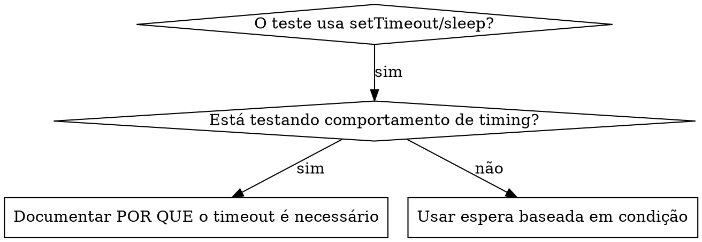

# Espera Baseada em Condição

## Visão Geral

Testes instáveis (flaky) frequentemente chutam o timing com atrasos arbitrários. Isso cria condições de corrida em que os testes passam em máquinas rápidas, mas falham sob carga ou no CI.

**Princípio central:** Espere pela condição real que importa, não por um palpite de quanto tempo ela leva.

## Quando Usar



**Use quando:**
- Os testes têm atrasos arbitrários (`setTimeout`, `sleep`, `time.sleep()`)
- Os testes são instáveis (passam às vezes, falham sob carga)
- Os testes estouram o timeout quando executados em paralelo
- For preciso esperar operações assíncronas terminarem

**Não use quando:**
- Estiver testando comportamento real de timing (intervalos de debounce, throttle)
- Sempre documente POR QUE, se usar um timeout arbitrário

## Padrão Central

```typescript
// ❌ BEFORE: Guessing at timing
await new Promise(r => setTimeout(r, 50));
const result = getResult();
expect(result).toBeDefined();

// ✅ AFTER: Waiting for condition
await waitFor(() => getResult() !== undefined);
const result = getResult();
expect(result).toBeDefined();
```

## Padrões Rápidos

| Cenário | Padrão |
|---------|--------|
| Esperar por evento | `waitFor(() => events.find(e => e.type === 'DONE'))` |
| Esperar por estado | `waitFor(() => machine.state === 'ready')` |
| Esperar por contagem | `waitFor(() => items.length >= 5)` |
| Esperar por arquivo | `waitFor(() => fs.existsSync(path))` |
| Condição complexa | `waitFor(() => obj.ready && obj.value > 10)` |

## Implementação

Função genérica de polling:
```typescript
async function waitFor<T>(
  condition: () => T | undefined | null | false,
  description: string,
  timeoutMs = 5000
): Promise<T> {
  const startTime = Date.now();

  while (true) {
    const result = condition();
    if (result) return result;

    if (Date.now() - startTime > timeoutMs) {
      throw new Error(`Timeout waiting for ${description} after ${timeoutMs}ms`);
    }

    await new Promise(r => setTimeout(r, 10)); // Poll every 10ms
  }
}
```

Veja `condition-based-waiting-example.ts` neste diretório para a implementação completa com helpers específicos do domínio (`waitForEvent`, `waitForEventCount`, `waitForEventMatch`) vindos de uma sessão de depuração real.

## Erros Comuns

**❌ Polling rápido demais:** `setTimeout(check, 1)` - desperdiça CPU
**✅ Correção:** Faça polling a cada 10ms

**❌ Sem timeout:** Loop infinito se a condição nunca for atendida
**✅ Correção:** Sempre inclua um timeout com erro claro

**❌ Dados obsoletos:** Guardar o estado em cache antes do loop
**✅ Correção:** Chame o getter dentro do loop para obter dados atualizados

## Quando um Timeout Arbitrário É o Correto

```typescript
// Tool ticks every 100ms - need 2 ticks to verify partial output
await waitForEvent(manager, 'TOOL_STARTED'); // First: wait for condition
await new Promise(r => setTimeout(r, 200));   // Then: wait for timed behavior
// 200ms = 2 ticks at 100ms intervals - documented and justified
```

**Requisitos:**
1. Primeiro, espere pela condição que dispara o comportamento
2. Baseie-se em timing conhecido (não em chute)
3. Comentário explicando POR QUÊ

## Impacto no Mundo Real

De uma sessão de depuração (2025-10-03):
- 15 testes instáveis corrigidos em 3 arquivos
- Taxa de aprovação: 60% → 100%
- Tempo de execução: 40% mais rápido
- Sem mais condições de corrida
