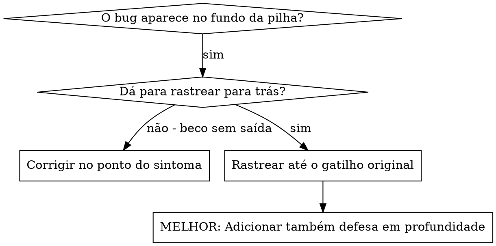
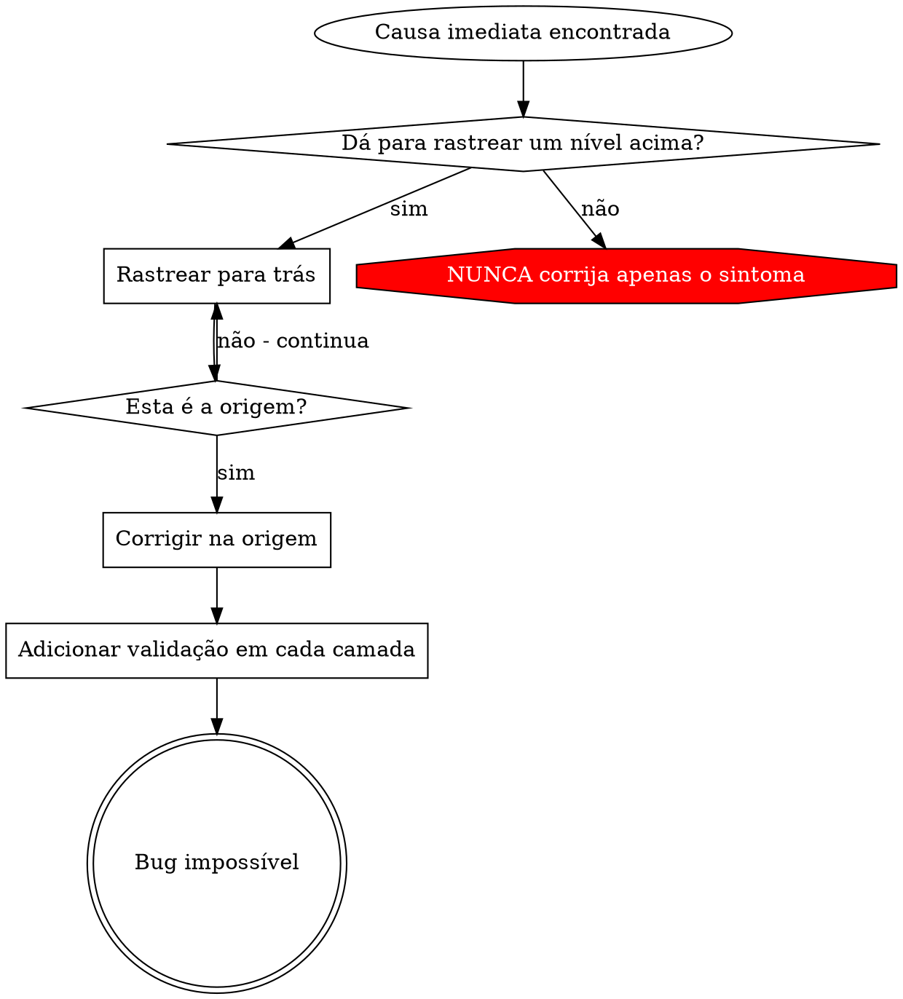

# Rastreamento da Causa Raiz

## Visão Geral

Bugs frequentemente se manifestam no fundo da pilha de chamadas (git init no diretório errado, arquivo criado no local errado, banco de dados aberto com o caminho errado). Seu instinto é corrigir onde o erro aparece, mas isso é tratar um sintoma.

**Princípio central:** Rastreie para trás pela cadeia de chamadas até encontrar o gatilho original e, então, corrija na origem.

## Quando Usar



**Use quando:**
- O erro acontece no fundo da execução (não no ponto de entrada)
- O stack trace mostra uma longa cadeia de chamadas
- Não está claro onde os dados inválidos se originaram
- É preciso descobrir qual teste/código dispara o problema

## O Processo de Rastreamento

### 1. Observe o Sintoma
```
Error: git init failed in ~/project/packages/core
```

### 2. Encontre a Causa Imediata
**Qual código causa isto diretamente?**
```typescript
await execFileAsync('git', ['init'], { cwd: projectDir });
```

### 3. Pergunte: O Que Chamou Isto?
```typescript
WorktreeManager.createSessionWorktree(projectDir, sessionId)
  → called by Session.initializeWorkspace()
  → called by Session.create()
  → called by test at Project.create()
```

### 4. Continue Rastreando para Cima
**Qual valor foi passado?**
- `projectDir = ''` (string vazia!)
- String vazia como `cwd` resolve para `process.cwd()`
- Esse é o diretório do código-fonte!

### 5. Encontre o Gatilho Original
**De onde veio a string vazia?**
```typescript
const context = setupCoreTest(); // Returns { tempDir: '' }
Project.create('name', context.tempDir); // Accessed before beforeEach!
```

## Adicionando Stack Traces

Quando não conseguir rastrear manualmente, adicione instrumentação:

```typescript
// Before the problematic operation
async function gitInit(directory: string) {
  const stack = new Error().stack;
  console.error('DEBUG git init:', {
    directory,
    cwd: process.cwd(),
    nodeEnv: process.env.NODE_ENV,
    stack,
  });

  await execFileAsync('git', ['init'], { cwd: directory });
}
```

**Crítico:** Use `console.error()` nos testes (não o logger - ele pode não aparecer)

**Execute e capture:**
```bash
npm test 2>&1 | grep 'DEBUG git init'
```

**Analise os stack traces:**
- Procure nomes de arquivos de teste
- Encontre o número da linha que dispara a chamada
- Identifique o padrão (mesmo teste? mesmo parâmetro?)

## Descobrindo Qual Teste Causa Poluição

Se algo aparece durante os testes, mas você não sabe qual teste é o responsável:

Use o script de bisseção `find-polluter.sh` neste diretório:

```bash
bash ./find-polluter.sh '.git' 'src/**/*.test.ts'
```

Executa os testes um por um e para no primeiro poluidor. Veja o script para saber como usar.

## Exemplo Real: projectDir Vazio

**Sintoma:** `.git` criado em `packages/core/` (código-fonte)

**Cadeia de rastreamento:**
1. `git init` roda em `process.cwd()` ← parâmetro cwd vazio
2. WorktreeManager chamado com projectDir vazio
3. Session.create() recebeu uma string vazia
4. O teste acessou `context.tempDir` antes do beforeEach
5. setupCoreTest() retorna `{ tempDir: '' }` inicialmente

**Causa raiz:** Inicialização de variável no nível superior acessando um valor vazio

**Correção:** tempDir passou a ser um getter que lança erro se acessado antes do beforeEach

**Também foi adicionada defesa em profundidade:**
- Camada 1: Project.create() valida o diretório
- Camada 2: WorkspaceManager valida que não está vazio
- Camada 3: Guarda de NODE_ENV recusa git init fora do tmpdir
- Camada 4: Log de stack trace antes do git init

## Princípio-Chave



**NUNCA corrija apenas onde o erro aparece.** Rastreie para trás até encontrar o gatilho original.

## Dicas de Stack Trace

**Nos testes:** Use `console.error()`, não o logger - o logger pode estar suprimido
**Antes da operação:** Registre o log antes da operação perigosa, não depois que ela falhar
**Inclua contexto:** Diretório, cwd, variáveis de ambiente, timestamps
**Capture a pilha:** `new Error().stack` mostra a cadeia de chamadas completa

## Impacto no Mundo Real

De uma sessão de depuração (2025-10-03):
- Causa raiz encontrada por meio de um rastreamento de 5 níveis
- Corrigido na origem (validação no getter)
- Adicionadas 4 camadas de defesa
- 1847 testes passaram, zero poluição
