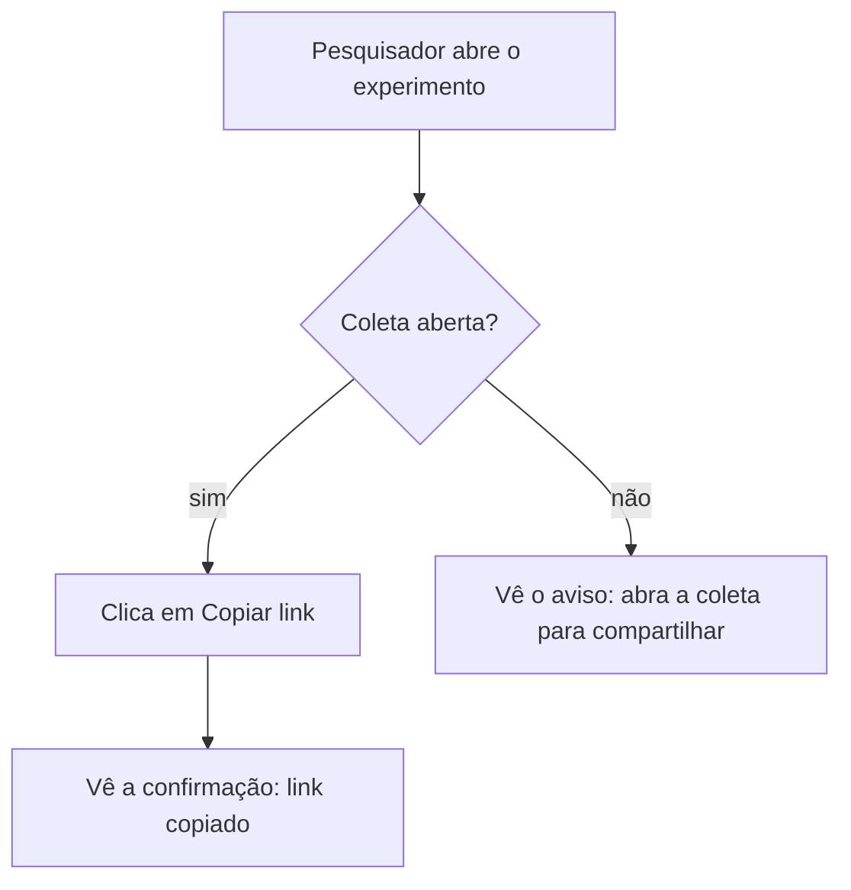
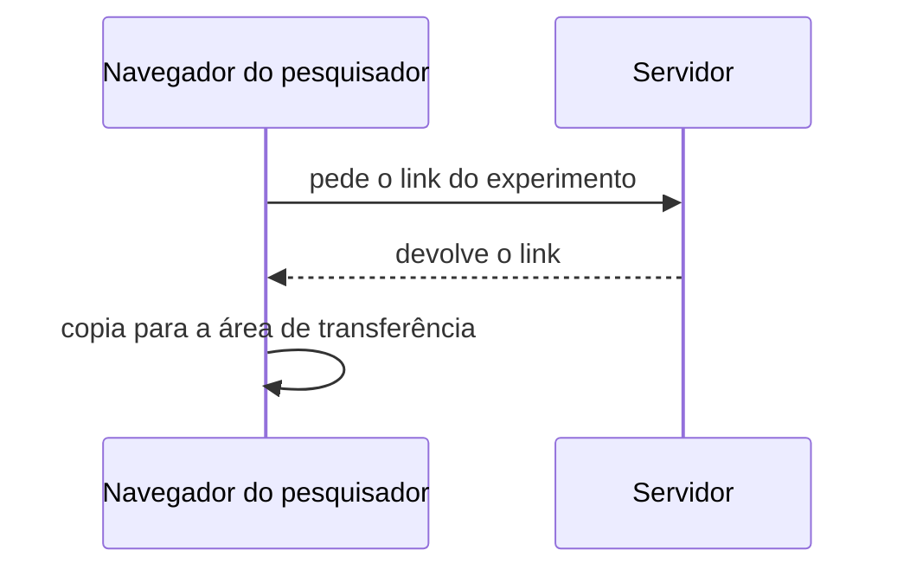
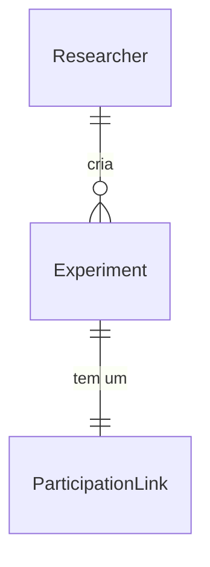

# Modelo de spec

Copie a partir de `# NNN`. Os diagramas abaixo são exemplos (spec de copiar o
link de participação): troque pelo conteúdo da spec. Omita uma seção marcada
como opcional quando ela não se aplicar.

````markdown
# NNN — <título curto>

**Critério:** C-NNN: Um <ator> consegue <resultado> <restrição mensurável>.
**Ator:** Pesquisador | Participante
**Depende de:** NNN-slug, NNN-slug (ou "nenhuma")
**Criado em:** AAAA-MM-DD
**Status:** Rascunho | Pronta para o plano

## Por quê

Uma ou duas frases: o problema do ator que esta spec resolve.

## Termos

Só o que esta spec introduz ou usa num sentido próprio.

Link de participação: o endereço que o pesquisador envia ao participante; abre o
experimento sem login.

## Fluxo



## Troca de dados *(opcional: só quando dados vão ao servidor ou voltam)*



## Cenários de aceitação

1. **Dado** <estado>, **quando** <ação do ator>, **então** <resultado observável>.

(De 2 a 5 cenários. O primeiro é o caminho feliz que prova o critério.)

## Casos de borda

- <situação> → <comportamento esperado>

## Dados *(opcional: só quando a spec cria ou altera dados)*



| Entidade | Informação | Regra |
| :--- | :--- | :--- |
| Experimento | link de participação | único; não dá para adivinhar o de outro experimento |

Modelo físico: [dados/modelo-de-dados.md](../../../dados/modelo-de-dados.md),
alterado pelo `plan.md` desta spec.

## Fora de escopo

- <o que alguém poderia esperar desta spec, mas fica para outra> (cite a spec, se existir)

## Perguntas em aberto

- <decisão ainda não tomada> (remova a seção quando estiver vazia)
````
