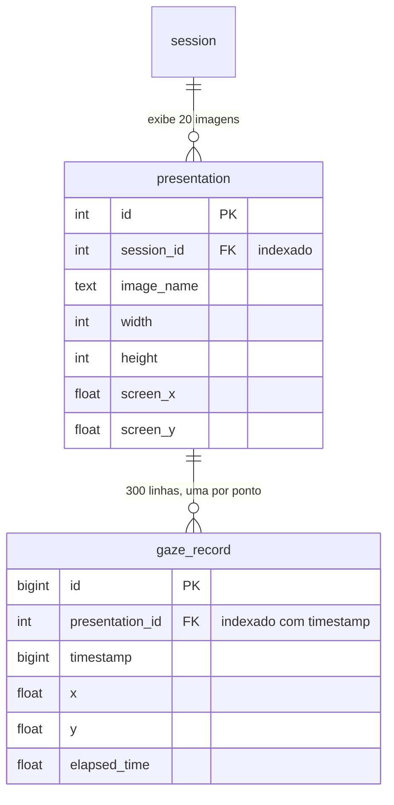
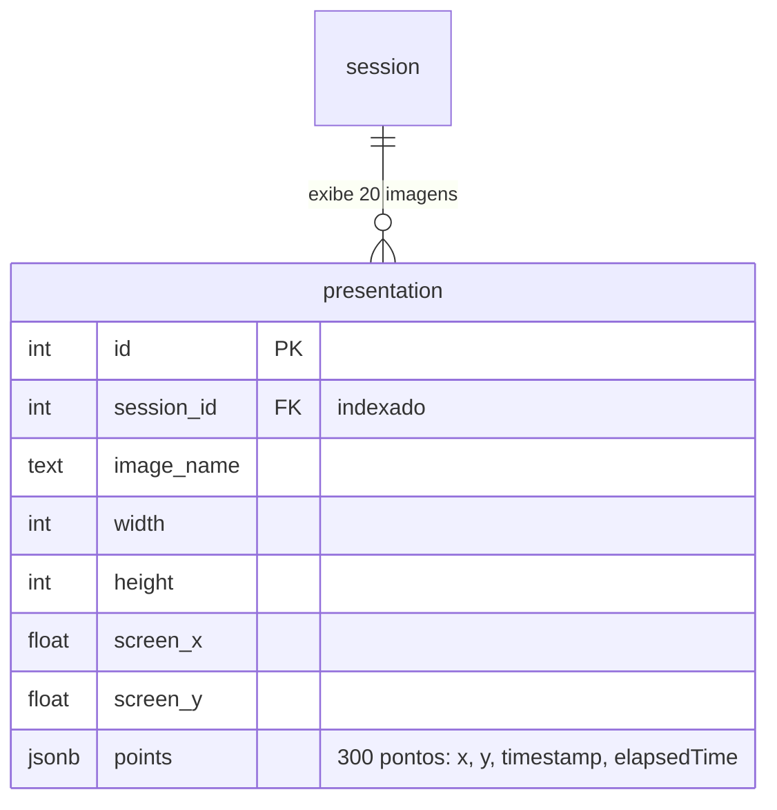

# Benchmark: onde e como guardar os registros de olhar

**Data:** 2026-10-19
**Decisão que embasa:** [ADR 0001](../../docs/decisoes/0001-backend-nestjs-prisma-postgres.md)
(PostgreSQL como banco único) e o formato dos registros de olhar, a decidir no
`plan.md` da spec de envio dos dados.

## Pergunta

Os registros de olhar são o maior volume de dados do TOV: o `DataCollector`
guarda um ponto a cada 33 ms (~30 por segundo). A dúvida era se valia usar o
MongoDB só para eles, por custo, velocidade ou escala, ao lado do PostgreSQL 18
que guarda o resto.

## Método

Cada banco roda sozinho num contêiner Docker com **4 CPUs, 4 GB de RAM e 1 GB de
cache**. Foram testados 4 formatos:

| Formato | Como um ponto é guardado |
| :--- | :--- |
| `postgres-rows` | uma linha por ponto, ligada à exibição da imagem |
| `postgres-array` | uma linha por imagem exibida, com os pontos num campo `jsonb` |
| `mongo-docs` | um documento por ponto |
| `mongo-embedded` | um documento por imagem exibida, com os pontos num array |

Os dois formatos do Postgres, como foram testados
(`scripts/postgres-schema.mjs`). Os do Mongo têm a mesma forma, com documentos no
lugar das linhas.

*`postgres-rows`: 6 mil linhas por sessão.*

*`postgres-array`: 20 linhas por sessão.*

- **Volume:** 1.000 sessões × 20 imagens × 300 pontos (10 s por imagem) =
  **6 milhões de pontos** por formato. Os dados são falsos, mas determinísticos
  (`scripts/session.mjs`).
- **Gravação:** cada sessão é enviada de uma vez, no fim, numa transação, com
  **10 participantes enviando ao mesmo tempo**.
- **Durabilidade igual:** o Postgres usa o padrão (`synchronous_commit = on`) e
  o Mongo grava com `{ w: 1, j: true }`. Nos dois, o banco só confirma depois de
  gravar no disco.
- **Disco:** tamanho das tabelas ou coleções somado ao dos índices, como o
  próprio banco informa.
- **Leitura:** gerar o CSV completo (formato do `docs/DATA_DICTIONARY.md`) de
  100 sessões sorteadas, com os dados já em cache.
- **Repetição:** 3 execuções completas; a tabela mostra a mediana. Os valores
  brutos estão em `resultados.jsonl`.

## Resultados (mediana de 3 execuções)

| Formato | Disco | Bytes por ponto | Gravar 6 mi pontos | Envio de 1 sessão (p50 / p95) | CSV de 1 sessão (p50 / p95) |
| :--- | ---: | ---: | ---: | ---: | ---: |
| `postgres-rows` | 819 MB | 143,2 | 33,0 s | 234 / 986 ms | 20 / 23 ms |
| **`postgres-array`** | **159 MB** | **27,7** | **5,1 s** | **40 / 84 ms** | **12 / 15 ms** |
| `mongo-docs` | 345 MB | 60,4 | 16,5 s | 120 / 485 ms | 28 / 35 ms |
| `mongo-embedded` | 183 MB | 31,9 | 6,4 s | 51 / 111 ms | 13 / 17 ms |

p50 é o tempo típico; p95 é o tempo que 95% das sessões não ultrapassam. Cada CSV
de sessão tem 0,75 MB.

## Conclusões

1. **O formato pesa mais que o banco.** Guardar um array por imagem gasta de 4 a 5
   vezes menos disco e grava de 3 a 6 vezes mais rápido do que uma linha (ou
   documento) por ponto, nos dois bancos.
2. **No mesmo formato, o Postgres empata ou ganha.** `postgres-array` ficou à
   frente de `mongo-embedded` em disco, gravação e leitura.
3. **Nenhum formato chegou perto de um limite.** Com 10 envios simultâneos, a
   sessão mais lenta do melhor formato levou cerca de 0,1 s para ser salva.
4. **O MongoDB não se justifica:** não traz ganho medido e acrescentaria um
   segundo serviço, um segundo backup, nenhuma transação entre os bancos e
   exclusão de dados (LGPD) em dois lugares.

**Recomendação:** PostgreSQL apenas, com um registro por imagem exibida e os
pontos num campo `jsonb` (`Json` no Prisma). Custo: não dá para consultar pontos
individuais com índice. Análise dos dados está fora do escopo e o uso principal é
baixar o CSV, então isso não pesa hoje. Se pesar, o Postgres consegue abrir o
array numa consulta (`jsonb_array_elements`).

## Limites

- Uma máquina só; os tempos absolutos variam entre máquinas e entre execuções
  (uma rodada exploratória anterior teve tempos 1,5 a 2 vezes maiores, com a
  mesma ordem entre os formatos). Compare os formatos entre si.
- Leitura com cache quente; com o cache frio, as leituras seriam mais lentas.
- Envio de uma vez no fim da sessão. O envio em lotes durante a sessão ainda
  está em aberto nas specs.
- Não testados: coleções de séries temporais do Mongo, compressão `lz4` do
  Postgres, partições e TimescaleDB.

## Ambiente

Linux (kernel 7.2.6), 12 CPUs, 31 GB de RAM, SSD NVMe; Docker 29.1.3;
Node 22.13.0; `postgres:18.4`; `mongo:8.3.13`; drivers `pg` 8.23.1 e
`mongodb` 6.21.0.

## Como repetir

Ver [TLDR.md](./TLDR.md).
