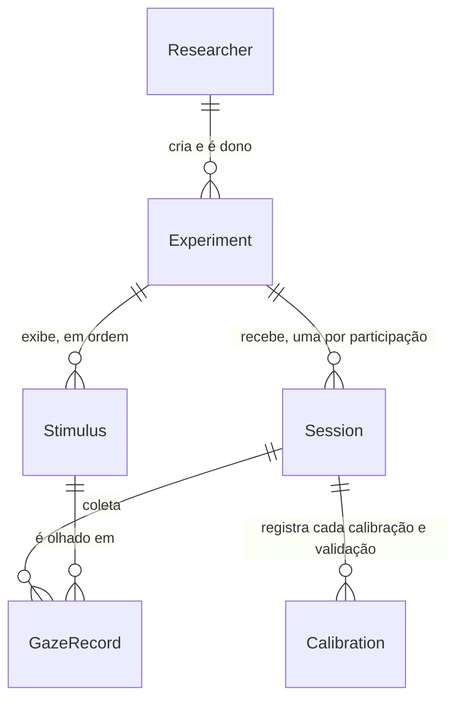

# Modelo de dados do TOV

Fonte única do modelo de dados do backend (NestJS + Prisma + PostgreSQL 18, ver
[ADR 0001](../docs/decisoes/0001-backend-nestjs-prisma-postgres.md)). Quando o
`schema.prisma` existir, todo diagrama e toda tabela daqui batem com ele; se
divergirem, o schema está certo e este arquivo é corrigido no mesmo commit.

O formato do CSV exportado continua em
[docs/DATA_DICTIONARY.md](../docs/DATA_DICTIONARY.md).

## Quem altera o quê

| Parte | Quem altera | Quando |
| :--- | :--- | :--- |
| [Visão conceitual](#visão-conceitual) | a spec (skill `writing-specs`) | ao criar uma entidade ou relação nova |
| [Modelo físico](#modelo-físico) | o `plan.md` da spec, por uma tarefa do `tasks.md` | junto com a migração do Prisma |

## Visão conceitual

O que o sistema guarda e como as coisas se ligam, sem tipos nem colunas. Os nomes
são os do código (glossário do `AGENTS.md`). Ponto de partida: entidades da spec
[001-experimento-remoto](../specs/planejadas/001-experimento-remoto/spec.md)
(rascunho).

| Entidade | Guarda | Regra que vale para todas as specs |
| :--- | :--- | :--- |
| `Researcher` | conta do pesquisador (e-mail e senha) | só vê os próprios experimentos e dados |
| `Experiment` | nome, instruções, configurações, situação da coleta, link de participação | não pode mudar estímulos nem configurações depois de ter sessões |
| `Stimulus` | imagem, nome original, ordem | pertence a um experimento |
| `Session` | código do participante, aceite do termo, situação, início e fim, dados da tela e do navegador | nenhum dado pessoal além do código |
| `Calibration` | precisão e momento de cada calibração ou validação | pertence a uma sessão |
| `GazeRecord` | pontos de olhar enquanto uma imagem está na tela, e a posição e o tamanho da imagem | nunca imagem ou vídeo da webcam (constituição) |

## Modelo físico

*Ainda vazio: nenhuma spec com backend chegou ao `plan.md`.* Cada plano acrescenta
aqui o que cria, neste formato:

1. **Tabela de modelos**: `Modelo | Tabela | Guarda`, uma linha por modelo.
2. **Diagrama `erDiagram` físico**: atributos com tipo, `PK`, `FK`, `UK` e um
   comentário com a regra, como `string email UK "único; usado para entrar"`.
   Um diagrama por assunto, com no máximo ~10 entidades.
3. **Uma seção por modelo**: tabela `Coluna | Tipo (Prisma) | Regra`, depois
   **Índices** (cada um com a consulta que ele atende) e **Por quê** para toda
   escolha não óbvia, com a alternativa descartada (constituição VIII).
4. **Enums**: valores e o que cada um significa.

Decisão já tomada para os registros de olhar: Postgres, não MongoDB. O formato
recomendado (um registro por imagem exibida, pontos num `jsonb`) e os números
estão no [benchmark](./armazenamento-do-olhar/README.md); a escolha final fica no
`plan.md` da spec de envio dos dados.
